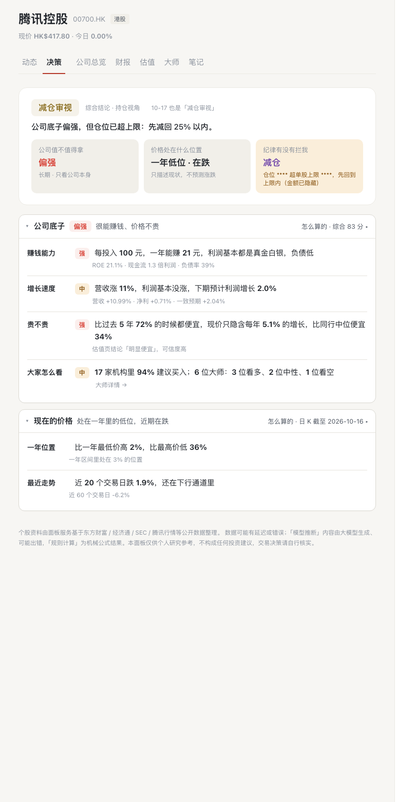
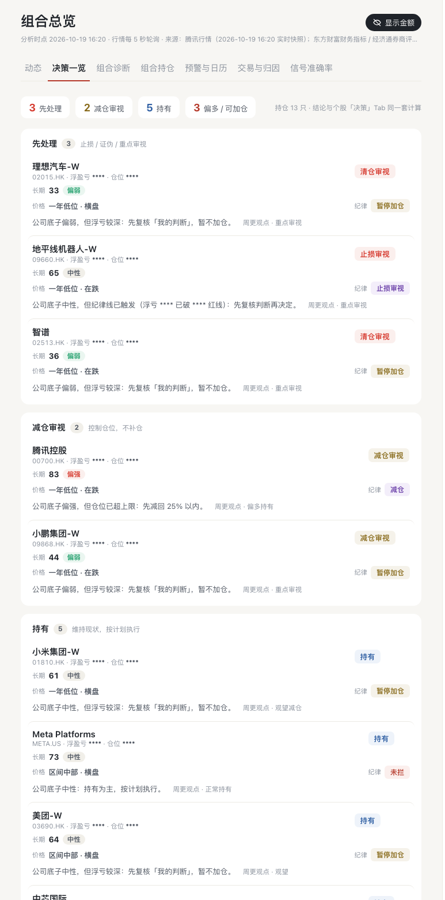
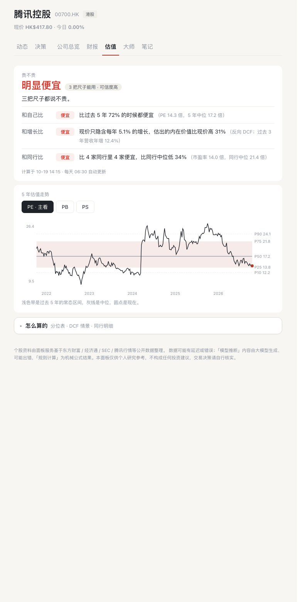
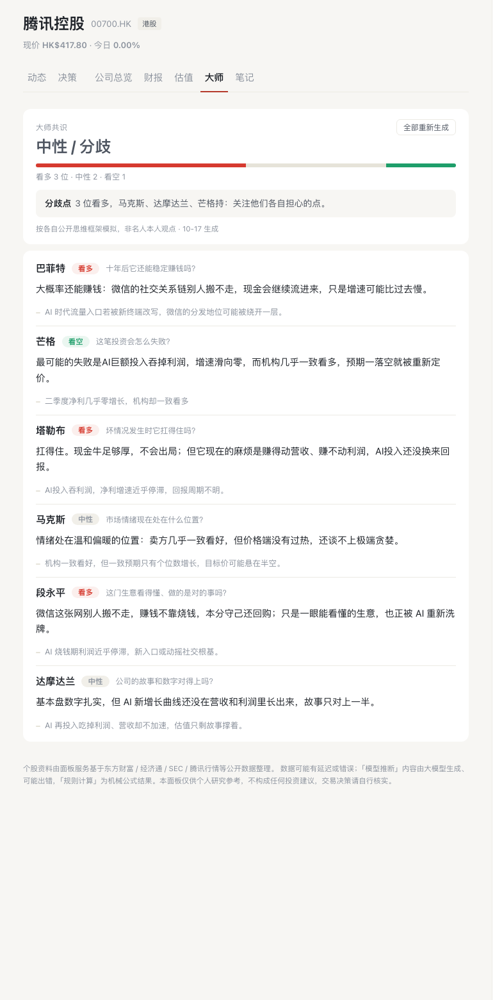

# Invest Buddy · 投资 Buddy

**你的 AI 投资助手，敢不敢把每条结论记账、三个月后给你看成绩单？**

Invest Buddy 是一个完全运行在你自己电脑上的投资决策系统：它不预测涨跌，只做三件别人不做的事——**把口径统一、把数字核清、把结论记账**。

## 界面一览

| 个股决策 | 组合决策一览 |
|---|---|
|  |  |

| 三口径估值 | 大师多视角 |
|---|---|
|  |  |

> 截图均开启隐私模式（`?privacy=1`）：持仓金额、仓位、盈亏全部打码。

## 为什么是它

大多数 AI 投资工具让模型既当分析师又当计算器——数字张口就来，错了没人知道。Invest Buddy 反过来设计：

- 🧮 **数字全由程序算** —— 财务比率、估值分位、仓位、归因、胜率都是确定性代码的输出；模型写出的每个关键数字都要经过程序对账（受控扰动实验：检出率 96–100%，误报率 0）。
- 📒 **每条结论都记账** —— 价格信号与大师观点每日进入前向账本，20 / 60 / 120 个交易日后自动核对方向与超额收益；判定按有效样本量做统计显著性修正，「弱有效」就如实写弱有效。
- ⚖️ **估值有三把尺子** —— 和自己比（5 年分位）、和增长比（反向 DCF）、和同行比（可比公司）；数据不足时可信度降级、结论自动封顶「偏」，绝不硬答。
- 🚦 **评分归评分，纪律归纪律** —— 「公司好不好」和「该不该动」是两笔账：浮亏破红线、仓位超上限、判断被证伪时，纪律闸门优先于评分结论。
- 🔒 **本地优先** —— 持仓、成本、盈亏永不离开本机；联网搜索的查询词由服务端做私有数据指纹拦截，命中即拒发。
- 💬 **能问能办** —— 内置问答代理支持 22 种操作（记流水、写计划、设预警、刷新数据……），全部以确认卡形式呈现，你点头才执行。

## 快速开始

要求：Python ≥ 3.11，macOS / Linux。

```bash
./deploy/install_local.sh   # 创建 .venv、data/ 目录与空白配置
cp .env.example .env        # 填写 DEEPSEEK_API_KEY（必须）
./start.sh                  # 打开 http://127.0.0.1:7788/
```

`.env.example` 里每一项都注明了获取方式与缺失时的降级行为。服务默认仅绑定回环地址，请勿公网暴露。macOS 开机自启：`./deploy/install_launchd.sh install`（在系统「终端.app」中执行）。

## 论文与实验

方法与六组实验的完整论述见论文 **[paper.zh-CN.md](paper.zh-CN.md)**（含与 TradingAgents 同协议的回测对标、数字对账消融、盲标集情绪评测等）；实验代码与数据快照在 [experiments/](experiments/)。

## 免责声明

本项目为个人研究工具，所有内容基于公开数据与量化分析，仅供参考，**不构成投资建议**。市场有风险，投资需谨慎。

## License

MIT © Jay Wu
