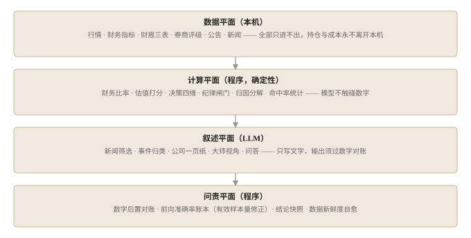

# Invest Buddy（投资 Buddy）

> 面向个人投资者的**本地优先、可问责**的 LLM 投资决策系统。
> 程序负责一切数字，LLM 只负责叙述；每条结论记账，到期核对；每个模型写出的数字，都要过程序对账。

## 这是什么

一个完全运行在你自己电脑上的投资决策面板：数据采集（行情 / 财报 / 研报 / 公告 / 新闻）→ 估值（三口径 + 可信度门控）→ 决策（四维打分 × 纪律闸门）→ 执行（交易流水）→ 记账（四项收益归因）→ 复盘（前向准确率账本），外加一个能问能办的问答代理（22 种操作全部以确认卡形式由你点确认后才执行）。

设计立场一句话：**不预测价格，只把账记清楚。** 价格信号经有效样本量修正后如实呈现为「弱有效」，因此只用于描述现状，不参与决策结论。

## 与同类工作的差异

- **数字由程序计算**：财务比率、估值分位、仓位、归因、胜率全部是确定性代码的输出；LLM 写出的每个关键数字都要经过程序对账（受控扰动实验测得检出率 96–100%，误报率 0）。
- **结论可追责**：每条信号与每位大师观点进入前向账本，20 / 60 / 120 个交易日后核对方向与超额收益；判定按有效样本量（n_eff = n/h）做统计显著性修正。
- **本地优先**：持仓、成本、盈亏永不离开本机；联网搜索前由程序拦截私有词（持仓数量、成本价命中即拒绝发送）。
- **能问能办**：问答代理可执行 22 种操作（记流水 / 写计划 / 设预警 / 刷新数据等），全部走确认卡。

完整方法与实验见论文：[paper.zh-CN.md](paper.zh-CN.md)（实验代码与数据快照在 [experiments/](experiments/)）。

## 系统架构



## 快速开始

要求：Python ≥ 3.11，macOS / Linux。

```bash
./deploy/install_local.sh   # 创建 .venv、data/ 目录与空白配置
cp .env.example .env        # 填写 DEEPSEEK_API_KEY（必须）
./start.sh                  # 打开 http://127.0.0.1:7788/
```

`.env.example` 里每一项都注明了获取方式与缺失时的降级行为。服务默认仅绑定回环地址，请勿通过公网映射暴露。

macOS 开机自启（在系统「终端.app」中执行）：

```bash
./deploy/install_launchd.sh install
```

## 隐私与安全

- 你的持仓、成本、交易记录只存在本机 `data/` 目录；
- 联网搜索的查询词由服务端做私有数据指纹拦截；
- 所有会修改数据的操作（含问答代理的动作）必须经确认卡由你手动确认；
- 发布包构建脚本带白名单审计，拒绝打包任何用户数据目录与符号链接。

## 免责声明

本项目为个人研究工具，所有内容基于公开数据与量化分析，仅供参考，**不构成投资建议**。市场有风险，投资需谨慎。

## License

MIT © Jay Wu
