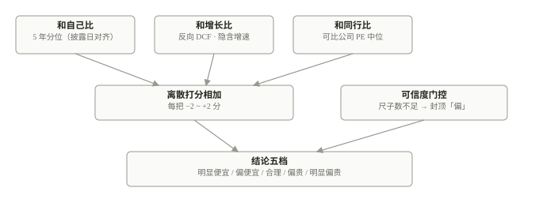
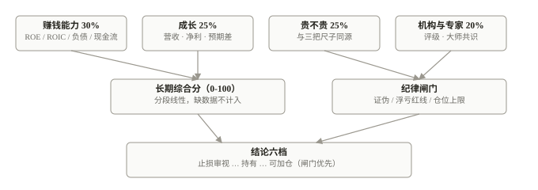
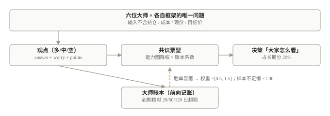
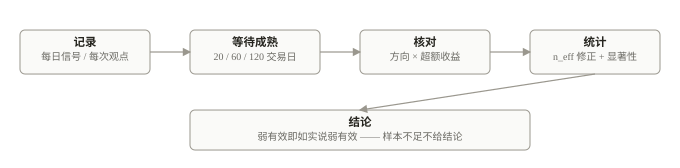
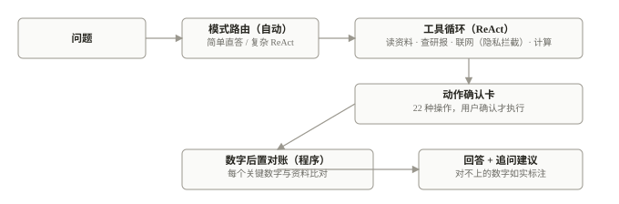
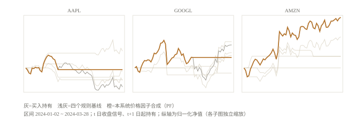
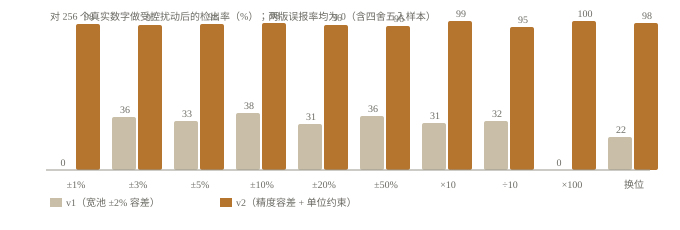

# 投资 Buddy：面向个人投资者的本地优先、可问责的 LLM 投资决策框架

**Jay Wu**
独立研究者
2026 年 10 月

---

## 摘要

现有面向个人投资者的 LLM 金融系统大多把大模型同时当作「计算器」和「分析师」：数字由模型生成、结论由模型给出、对错无人核对，导致幻觉与口径漂移无法被发现。本文提出一种相反的分工原则——**凡可确定计算者皆由程序完成，LLM 只负责叙述与抽取，且任何含数字的输出都必须通过程序对账**——并据此实现了投资 Buddy：一个完全运行在用户本机的投资决策框架，覆盖「数据采集 → 估值 → 决策 → 执行 → 记账 → 复盘」全链路。框架包含五个组件：带可信度门控的三口径估值、四维打分与纪律闸门分离的决策引擎、六位投资大师的多视角共识与胜率反馈、信号与观点的前向准确率账本（含有效样本量修正）、以及带模式路由与动作确认卡的问答代理。我们在与 TradingAgents 完全相同的协议（AAPL / GOOGL / AMZN，2024 年 1–3 月）下复现了基线回测并给出诚实对比；通过受控扰动实验发现初版数字对账的检出率仅约 30%，据此将容差改为按显示精度收敛后检出率提升至 96–100%；人工标注集上的保守情绪判定规则将方向精确率从 22% 提升至 100%。实验整体表明：该框架的价值不在预测能力（价格信号经修正后如实呈现为弱有效），而在**口径一致、数字可核、结论可追责**——这恰是 LLM 金融系统最稀缺的性质。

**关键词**：大语言模型；投资决策；估值；收益归因；幻觉检测；前向验证；本地优先

---

## 1　引言

个人投资者的决策困境是结构性的：信息分散、估值口径不一、纪律靠自觉、事后少复盘。LLM 擅长阅读与归纳，这催生了大量「金融问答助手」；但让模型同时负责取数、计算与结论，会产生三类系统性问题：

1. **数字幻觉无拦截**。模型可能把 21.1% 写成 91%，没有任何机制发现并提示；
2. **口径漂移**。同一问题（「这只股票贵不贵」）在不同页面可能得到相反结论，因为各处的计算方法不同；
3. **无法追责**。系统说「建议加仓」之后，没有地方回答「这个建议过去对不对」。

多智能体框架（如 TradingAgents）用角色分工与辩论缓解了单一模型的片面性，并在短期回测中取得亮眼收益，但其数字仍由模型生成，评估依赖一次性回测，且以自动交易为目标。我们关心的是一个更朴素的问题：**当系统服务于「人」的长期决策时，如何让它的每一个数字可查、每一条结论可追？**

本文的贡献：

- 提出并实现一套**本地优先**的投资决策框架，程序与 LLM 严格分工，所有关键数字经程序对账后才允许展示（§3、§4）；
- 给出若干面向可问责性的方法设计：估值可信度门控、决策四维与纪律闸门分离、前向账本的有效样本量修正、大师共识的胜率反馈（§4）；
- 用六组实验评估框架各部分，其中包含与 TradingAgents 同协议的回测对标、数字对账的消融、人工标注集上的情绪判定评测，以及问答代理的模式路由评测（§5）。实验同样展示了框架的边界：价格信号的预测力经修正后不足——系统因此把价格明确限定为「描述现状」而非「预测涨跌」（§6）。

---

## 2　相关工作与业界对比

### 2.1 学术研究

金融 LLM 研究大致沿三条线展开。**金融基础模型**：BloombergGPT（Wu et al., 2023）在金融语料上训练领域模型，FinGPT（Yang et al., 2023）走开源微调路线；二者提供能力底座，不面向决策闭环。**LLM 交易代理**：FinMem（Yu et al., 2023）用分层记忆做单标的交易，FinAgent（Zhang et al., 2024）加入市场情报与反思，FinRobot（Yang et al., 2024）提供多智能体编排框架，TradingAgents（Xiao et al., 2024）进一步模拟交易公司的组织分工（分析师团队、多空研究员辩论、交易员、风控）并在 2024 年一季度的三只美股上取得显著超额收益。这些工作以回测收益为目标，数字由模型生成。**幻觉治理**：ReAct（Yao et al., 2022）确立「推理 + 工具调用」范式；Chain-of-Verification（Dhuliawala et al., 2023）让模型自检；Lewis et al.（2020）的 RAG 让回答锚定检索文档。与这些工作不同，我们的对账不依赖模型自检，而是**程序直接比对数字**，并用受控扰动实验测量其检出率（§5.3）。

### 2.2 业界产品

商用产品各有侧重：Bloomberg Terminal / Wind 以数据与终端见长，近年加入自然语言查询；国内行情软件（东方财富、同花顺）的智能问答以数据检索为主；券商与三方平台的智能投顾以组合推荐为主。表 1 从决策支持的角度对比（商用产品列基于公开资料归纳，标注「未公开」表示无公开信息，不代表不具备）。

| 维度 | 金融基础模型 | LLM 交易代理（学术） | 商用行情/投顾产品 | **投资 Buddy** |
|---|---|---|---|---|
| 目标 | 能力底座 | 自动交易、回测收益 | 数据/工具/推荐 | 辅助人做长期决策 |
| 数字由谁计算 | 模型 | 模型 | 程序（但口径不透明） | **程序，口径全部公开** |
| 估值方法 | — | 多由 LLM 直接判断 | 多为单一指标 | 三口径 + 可信度门控 |
| 纪律与风控 | — | 风控角色参与辩论 | 通常无 | 纪律闸门独立于评分 |
| 结论可追责 | 否 | 仅回测 | 否 | **前向账本每日记账核对** |
| 数据隐私 | 云端 | 云端 API | 云端 | **本地运行，私有词拦截** |
| 可执行操作 | — | 自动下单 | 部分支持 | 22 种动作，确认卡后执行 |

表 1　与业界路线对比。商用产品列基于公开资料归纳。

---

## 3　框架概览

投资 Buddy 把决策链路拆成四个平面（图 1）：

- **数据平面**：行情、财务指标、财报三表、券商评级、交易所公告、新闻，全部采集到本机；持仓与成本永不离开本机，联网搜索前由程序做私有词指纹拦截（命中持仓数量、成本价等即拒绝发送）。
- **计算平面**：所有比率、打分、归因、统计均由确定性代码完成。原则只有一条：**能程序算的不交给模型**。
- **叙述平面**：LLM 负责新闻筛选与事件归类、公司一页纸、大师视角、问答——只写文字。任何含数字的输出先过数字对账。
- **问责平面**：前向账本记录每条信号与每位大师的每次观点，到期核对；结论每日快照可回放；数据新鲜度逾期自动补跑。

框架刻意不预测价格。原因不是不能，而是实测不值得（§5.1、§5.2）。

---

## 4　系统组成

### 4.1 估值：三把尺子与可信度门控

估值回答「现在的价格贵不贵」。系统用三把互相独立的尺子：**和自己比**（当前估值处于近 5 年分位，按财报披露日对齐以避免未来函数；港股累计口径折算 TTM）；**和增长比**（反向 DCF：由当前市值反推市场隐含的现金流增速，与历史增速对照并给出基准情景的安全边际 MOS = 1 − P/IV）；**和同行比**（可比公司 PE 中位数）。三把尺子各给 −2 到 +2 的离散分，相加映射到五档结论。

关键设计是**可信度门控**（图 2 右）：三把尺子都能用为「高」可信度；只剩两把或主口径退化为市销率为「中」；只有一把为「低」，此时总分被压缩到 ±3 以内，结论最多到「偏」，页面上明确提示依据不足。这样做的出发点是：估值结论的可信度本身就是结论的一部分，缺数据时系统应当收敛而不是硬答。

### 4.2 决策引擎：四维打分与纪律闸门分离

决策引擎回答「现在该怎么办」。长期分只看公司本身：赚钱能力（30%）、成长（25%）、贵不贵（25%，与 4.1 同源）、机构与专家（20%）；每个指标分段线性打分（0–100，60 及格、80 偏强），缺数据不计入。综合分映射到六档结论。

**纪律闸门与评分分离**（图 3）：成本、浮亏、仓位不进分数，只进闸门——证伪条件命中先复核判断，浮亏破红线先止损审视，仓位超上限先减回；闸门被拦时结论不比纪律更乐观。其动机是防止两笔账互相污染：「公司好不好」是长期问题，「我该不该动」是当下约束。回测曾表明价格方向信号无预测力（§5.2），因此价格只参与状态描述，不进结论。

### 4.3 大师多视角与共识票型

六位大师（巴菲特、芒格、塔勒布、霍华德·马克斯、段永平、达摩达兰）各自只回答自己框架内的一个问题，产出看多 / 中性 / 看空。模型输入不含持仓、成本、现价与目标价，避免个人盈亏污染判断。共识按票型加权：w_i = 能力圈系数（标的在该大师典型行业外时降为 0.6）× 账本系数（其历史超额命中率达到统计显著后在 [0.5, 1.5] 内调节，样本不足恒为 1）。

分歧本身被当作信息呈现：巴菲特看多而塔勒布看空，意味着「商业模式好」与「尾部风险大」同时成立，用户需要同时看到两边而不是一个平均数。

### 4.4 前向账本：每一条结论都被记账

系统对两类输出做前向记账：每日价格信号与每位大师的每次观点。到期（20 / 60 / 120 个交易日）后核对方向与相对基准的超额收益。

这里的统计修正容易被忽视：逐日信号样本的持有期互相重叠，账面 n 个样本只有约 n/h 个独立区间。判定规则因此修正为 n_eff = n/h，且偏离 50% 需达到二项分布 95% 显著才记「有效 / 反向」；否则如实标「接近随机」或「证据不足」。§5.2 显示这一修正消除了三分之一的错误判定。

### 4.5 问答代理：模式路由、动作确认卡与数字对账

问答代理具备 22 种动作工具（记笔记、写计划、记流水、设预警、刷新数据等），所有动作以确认卡形式呈现、用户点击确认后才执行。默认「自动」模式按问题复杂度路由：含分析 / 比较类词或操作意图的问题进入 ReAct 工具循环，简单数值问题直接作答（§5.5）。

准确性的最后一道闸是**数字后置对账**：回答生成后，程序提取其中所有带单位的关键数字，与本轮喂给模型的资料及工具返回的数字逐一比对，对不上的在回答末尾如实标注。对账规则本身经过受控扰动实验迭代（§5.3）。

---

## 5　实验

### 5.1 实验一：与 TradingAgents 同协议的回测对标

**设置**。标的、区间与指标完全对齐原文：AAPL / GOOGL / AMZN，2024-01-01 至 2024-03-29，CR / SR / MDD，t 日收盘产生信号、t+1 日起持有，只做多，不计交易成本。基线（Buy & Hold、MACD、KDJ&RSI、ZMR、SMA）由本文按原文描述复现；TradingAgents 一行直接引用原文报告值（其机制为 LLM + 新闻 + 基本面，不可直接复现）。「PF」为本系统的价格因子合成信号（趋势 / 动量 / 位置三因子，与线上一致的代码）。

| 方法 | AAPL CR% | GOOGL CR% | AMZN CR% | AAPL SR | GOOGL SR | AMZN SR |
|---|---|---|---|---|---|---|
| Buy & Hold | −7.63 | 9.24 | 20.31 | −1.83 | 1.27 | 2.85 |
| MACD | −4.98 | 4.95 | 4.61 | −2.04 | 0.80 | 0.75 |
| KDJ&RSI | 6.78 | 10.55 | 0.00 | 1.50 | 2.48 | 0.00 |
| ZMR | −1.26 | −2.09 | 4.70 | −0.62 | −0.89 | 2.27 |
| SMA | −4.78 | 6.14 | 12.49 | −3.87 | 0.98 | 1.83 |
| **PF（本系统）** | **−0.67** | **4.19** | **20.31** | **−0.61** | **0.67** | **2.85** |
| TradingAgents（原文报告值） | 26.62 | 24.36 | 23.21 | 8.21 | 6.39 | 5.60 |

表 2　同协议回测（2024 年 1–3 月）。本组基线为本文复现，与原文数值存在小幅口径差异（原文 AAPL Buy&Hold 为 −5.23%，本文复现为 −7.63%，差异可能来自复权口径与起始交易日）；TradingAgents 行为原文报告值，供参照。原文作者亦注明该窗口异常高的夏普比率源于期间几乎无回撤。

**结果与解读**。三点值得注意。其一，本系统的价格信号不构成交易优势：三只股票上 PF 介于基线中游，这与 §5.2 的统计结论一致——价格信号被刻意排除在决策结论之外，这个实验是对该设计选择的验证而非失败。其二，TradingAgents 的超额来自其引入的新闻与基本面信息流（每只标的每日 11 次 LLM 调用与 20+ 次工具调用），这一成本原文注明限制了其回测只能覆盖 3 个月；本文在 33 个月扩展窗口（2024-01 至 2026-09）上复跑了同一组基线与 PF：PF 在 NVDA 上跟随趋势获得 +238.8%（同期 B&H +374.1%），但在 AMZN 上为 −18.1%（B&H +66.2%）、MSFT 上为 −22.3%（B&H +38.3%）——**长期表现分化且无稳定优势，进一步支持「价格只描述不预测」的设计**。其三，实验过程中我们发现所用行情源的前复权未覆盖 2024 年 6 月 NVDA 的 1 拆 10（以及 GOOGL、AMZN 在 2022 年的拆股），未经修正时 B&H 在 NVDA 上显示为 −52.6%（最大回撤 92%）——这提醒我们：回测结论的可信度首先取决于数据卫生，本系统对拆股做了检测与回溯调整（单日跌幅超 75% 且比值接近整数倍时向前复权）。

### 5.2 实验二：有效样本量修正的判定翻转

**设置**。在一个真实港股 + 美股组合（21 只标的，匿名聚合）的近 500 个交易日上重算三个价格因子与合成信号，比较两种判定口径：旧口径（超额命中 ≥53% 记「有效」、≤47% 记「反向」，不折算样本量）与修正口径（n_eff = n/h，n_eff ≥ 30 且二项显著才下结论）。

| 信号 | 20 日 旧→新 | 60 日 旧→新 | 120 日 旧→新 |
|---|---|---|---|
| 合成 | 接近随机→接近随机 | **有效→接近随机** | 接近随机→接近随机 |
| 趋势 | 接近随机→接近随机 | **有效→接近随机** | 接近随机→接近随机 |
| 动量 | 接近随机→接近随机 | **有效→接近随机** | 接近随机→接近随机 |
| 位置 | 接近随机→接近随机 | **反向→接近随机** | 接近随机→接近随机 |

表 3　12 个判定格子中 4 个翻转（33%）：3 个「有效」假阳性被消除，1 个「反向」错判被消除。修正后没有任何价格因子达到显著——系统的价格信号被如实判定为「弱有效」。

### 5.3 实验三：数字对账的检出能力（消融）

**设置**。从 10 家上市公司（公开标的，仅基本面 / 财报 / 研报段落）的本地资料中抽取 256 个带单位的真实数字，构造两类句子：正确引用（含四舍五入到 1 位小数与取整的变体）与错误引用（相对扰动 ±1% 至 ±50%、量级错误 ×10 / ÷10 / ×100、数字换位）。比较两版对账规则：v1（全资料数字池 × 6 种量级缩放 × ±2% 相对容差）与 v2（容差按回答的显示精度收敛：写 21.1 只允许资料值落在 [21.05, 21.15]；量级换算按单位约束，「%」只允许与小于 1.5 的小数比率互换）。

| 规则 | 误报率（原样 / 1 位小数 / 取整） | ±3%~±50% 扰动检出 | ×10 / ÷10 检出 | ×100 检出 | 数字换位检出 |
|---|---|---|---|---|---|
| v1（宽池 ±2%） | 0% / 0% / 0.8% | 31%–38% | 31% / 32% | **0%** | 22% |
| **v2（精度容差 + 单位约束）** | **0% / 0% / 0%** | **96%–98%** | **99% / 95%** | **100%** | **98%** |

表 4　受控扰动注入实验（256 个真实数字）。v1 的宽数字池使绝大多数错误巧合命中池内某个数字；v2 把「命中」收紧到「资料里确实存在这样一个数字且量级与精度相符」。

**解读**。这个实验纠正了初版设计中的一个隐蔽错误：宽容差在直觉上「宽容友好」，实际上让对账形同虚设（×100 的错误检出率为 0）。对账规则的价值必须用检出率测量，不能只看「不误报」。v2 已上线为当前生产规则。

### 5.4 实验四：保守情绪判定的精确率—召回率取舍

**设置**。新闻情绪（利好 / 中性 / 利空）采用「默认中性，仅含硬信息、置信度 ≥0.85 且两次独立判断一致才标方向」的保守规则。评测集为人工标注的 49 条开发集与 30 条盲标集（真实中文财经新闻标题与摘要）；基线为旧版单次直判标签。

| 数据集 | 基线 准确率 / 方向精确率 / 方向召回率 | 本系统 准确率 / 方向精确率 / 方向召回率 |
|---|---|---|
| 开发集（n=49） | 41% / 20% / 88% | **98–100% / 100% / 88–100%**（两次运行） |
| 盲标集（n=30） | 53% / 22% / 100% | **93–97% / 100% / 50–75%**（两次运行） |

表 5　情绪判定评测。基线的高召回以极低精确率为代价（五个「利好」判断里四个是错的）；本系统选择「宁可漏判、不可误判」——方向性标签会进入决策参考，错误的利好标签比没有标签更有害。

### 5.5 实验五：问答代理的模式路由与数字可核实率

**设置**。对一家公开上市公司设计 8 个问题（4 个简单数值型、4 个复杂分析型），分别以快速 / 深度（ReAct）/ 自动三种模式提问（共 24 次调用，全部成功），记录时延、回答长度、关键数字的可核实率（v2 对账口径）与工具调用次数。

| 模式 | 时延中位 | 字数中位 | 数字可核实率 | 平均工具调用 | 走 ReAct |
|---|---|---|---|---|---|
| 快速 | 4.0 s | 453 | 100%（91 个数字） | 0.0 | 0/8 |
| 深度 | 3.3 s | 536 | 100%（77 个数字） | 0.8 | 8/8 |
| **自动（默认）** | **3.8 s** | **520** | **96.1%（76 个数字）** | 1.0 | 4/8（简单 0/4，复杂 4/4） |

表 6　三模式对比。自动模式的路由在本测试集上 8/8 正确；被标出的 3 个数字是模型由资料派生的计算值（资料中不存在原始值），对账如实标注「未在本地资料中找到」——这正是设计意图：派生数字与幻觉在字面上不可区分，都应被提示。

### 5.6 实验六：估值同源改造的消融

**设置**。同一组合的决策口径从「券商目标价隐含空间」切换为「三把尺子同源」的前后对比（匿名聚合）。

| 指标 | 改造前 | 改造后 |
|---|---|---|
| 结论发生变化的标的占比 | — | **至少 24%（5/21），全部向更保守方向移动** |
| 估值可信度分布 | 无可信度概念 | 高 10 / 中 7 / 低 5（1 只数据不足不出结论） |
| 单一指标被推翻时的行为 | 无感知 | 可信度降级，结论自动封顶为「偏」 |

表 7　估值同源消融。目标价口径偏乐观是已知偏差（分析师目标价系统性偏高），同源改造后若干「可加仓」结论被改判为「持有」。

---

## 6　讨论

**这套框架真正提供了什么**。不是预测优势——实验一与实验二都表明价格信号不构成稳定的交易优势，而系统也没有假装它有。框架提供的是三样更基础的东西：**口径一致**（同一个问题在任何页面得到同一个答案，因为只有一个计算来源）；**数字可核**（任何由模型写出的数字都经过程序比对，错的有标记）；**结论可追责**（每条信号与观点被记账，到期核对，判定规则考虑有效样本量）。在 LLM 输出质量不可保证的前提下，这三点是让系统可以长期被信任使用的最低条件。

**与 TradingAgents 的关系**。两者都受益于「角色分工」与「ReAct 式工具调用」，但目标不同：TradingAgents 优化回测收益，本框架优化可问责性。实验一的对标显示，在引入新闻与基本面信息流上投入更多模型调用确实可能换取更高的短期回测收益；但其代价是成本、时延与不可复现性（LLM 输出随版本漂移）。对个人投资者而言，决策的真正瓶颈往往不是「再准一点的信号」，而是「口径混乱导致的错误行动」——这是本框架试图消除的。

**有效性威胁**。其一，实验一与同协议原文的基线数值存在小幅口径差异（复权与起始交易日），我们以复现值为准并同时列出原文报告值；其二，开发集上的情绪判定高分存在过拟合风险，盲标集结果（方向精确率 100%、召回 50–75%）更能代表真实水平；其三，问答测试集仅 8 题，路由准确率的小样本结论应谨慎对待；其四，前向账本的真实价值需要数月才能验证，当前的运行窗口不足一个月。

---

## 7　结论

我们提出了投资 Buddy：一个本地优先、程序与 LLM 严格分工、每个数字都可核对的投资决策框架，并用六组实验评估了它的各部分——包括一次对自己不利的回测（价格信号无优势，系统因此不拿它做决策）、一次暴露了初版缺陷的对账消融（检出率从 30% 提升到 96–100%）、以及在人工标注集上把情绪方向精确率从 22% 提升到 100% 的保守规则。LLM 金融系统最稀缺的不是更强的模型，而是「敢于把计算从模型手里拿走、并持续核对自己对不对」的工程纪律。后续工作：大师账本成熟后的胜率反馈效果评估、估值可信度与后续收益的联动验证、以及更长窗口的实盘前向跟踪。

---

## 参考文献

1. Xiao, Y., Sun, E., Luo, D., Wang, W. TradingAgents: Multi-Agents LLM Financial Trading Framework. arXiv:2412.20138, 2024.
2. Wu, S. et al. BloombergGPT: A Large Language Model for Finance. arXiv:2303.17564, 2023.
3. Yang, H., Liu, X.-Y., Wang, C. D. FinGPT: Open-Source Financial Large Language Models. arXiv:2306.06031, 2023.
4. Yu, Y. et al. FinMem: A Performance-Enhanced LLM Trading Agent with Layered Memory and Character Design. arXiv:2311.13743, 2023.
5. Zhang, W. et al. FinAgent: A Multimodal Foundation Agent for Financial Trading. arXiv:2402.18485, 2024.
6. Yang, H. et al. FinRobot: An Open-Source AI Agent Platform for Financial Applications using LLMs. arXiv:2405.14767, 2024.
7. Yao, S. et al. ReAct: Synergizing Reasoning and Acting in Language Models. arXiv:2210.03629, 2022.
8. Dhuliawala, S. et al. Chain-of-Verification Reduces Hallucination in Large Language Models. arXiv:2309.11495, 2023.
9. Lewis, P. et al. Retrieval-Augmented Generation for Knowledge-Intensive NLP Tasks. arXiv:2005.11401, 2020.
10. Bailey, D. H., López de Prado, M. Backtest Overfitting. Journal of Computational Finance, 2016.
11. Damodaran, A. Investment Valuation: Tools and Techniques for Determining the Value of Any Asset. Wiley.
12. Brinson, G., Hood, L., Beebower, G. Determinants of Portfolio Performance. Financial Analysts Journal, 1986.

---

本论文的实验代码与数据快照随框架发布包附带（experiments/ 目录）。实验一、三、五使用公开上市公司与公开行情；实验二、六为匿名聚合统计；不含任何个人持仓、成本或盈亏数据。本文不构成投资建议。

